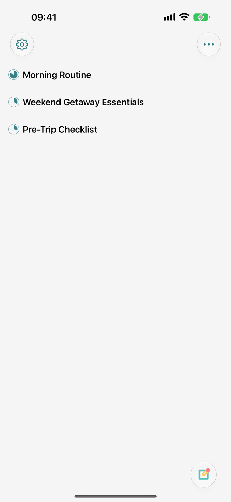
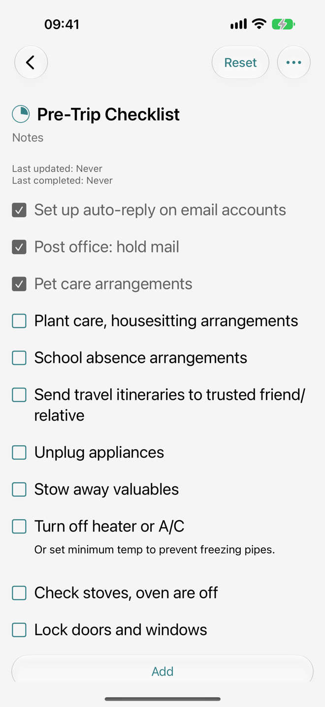

# reChecklist — Repeatable Checklists

> A native iPhone app for checklists you run again and again: routines, packing lists, pre-trip
> checks, anything worth never forgetting a step of. Built with SwiftUI, UIKit, SwiftData, and
> CloudKit sync.

[](https://apps.apple.com/us/app/rechecklist/id1475724536)

## About

Up through version 1.1, released in 2021, reChecklist was handwritten: a UIKit + Realm app.
Version 2.0 was updated agentically, by AI coding agents steered and reviewed by me (an iOS
developer for 15+ years): SwiftUI navigation, SwiftData with CloudKit sync, full localization, and
the tooling to keep all of it honest.

Its sibling project, [`simple-recurring-budgets`](https://github.com/jimmynotjames/simple-recurring-budgets)
(the **Wren** app), was built the same way, and most of this repo's tooling was ported from it.

**Agent and contributor instructions:** [AGENTS.md](AGENTS.md)

**Design docs:** [core-docs/](core-docs/)

---

## Screenshots

| Checklists | Checklist |
| ---------- | --------- |
|  |  |

---

## Status

- This repo is reChecklist 2.0 onward, the agentically updated successor to the handwritten 1.x
  app. 2.0 imports a 1.x install's data on first launch.
- Per-release App Store records live in [`releases/`](releases/).

---

## Features

- ✅ **Repeatable checklists** — check items off, then **Reset** to run the checklist again.
- 🕓 **History** — each checklist shows when it was last updated and last completed.
- 📝 **Notes** on checklists and on individual items.
- 🧬 **Duplicate** a checklist, or **copy or move checked items** into another one.
- 📄 **PDF export**, on Letter or A4 paper to match your region.
- ☁️ **iCloud sync** across your devices via CloudKit, with an in-app sync status.
- ⌨️ **Keyboard shortcuts** for hardware keyboards.
- 📱 **iPhone-only**, with an adaptive layout for iPhone Duo.
- 🌗 **Dark Mode**, **Dynamic Type**, **VoiceOver**, and **Reduce Motion** support throughout.
- 🌍 **Every App Store storefront locale**, including right-to-left languages.
- 🔒 **Privacy-first analytics** — consent-gated, no PII, off by default in strict-opt-in jurisdictions.
- 🚚 **One-time import** of a 1.x install's Realm data into SwiftData.

---

## Tech stack

| Layer                       | Choice                                                                                  |
| --------------------------- | --------------------------------------------------------------------------------------- |
| **Language**                | Swift 6.0 — strict concurrency, default `@MainActor` isolation                          |
| **UI**                      | SwiftUI app root and navigation (`NavigationSplitView` + `Router`); UIKit checklist detail (`ChecklistViewController`) |
| **Persistence**             | SwiftData                                                                               |
| **Sync**                    | CloudKit (private database)                                                             |
| **Legacy data**             | Realm, linked only for the one-time import from 1.x                                     |
| **Min OS**                  | iOS 27.2+                                                                               |
| **Analytics**               | Mixpanel + `OSLog`                                                                      |
| **Unit tests**              | Swift Testing (`@Test` / `#expect`)                                                     |
| **UI tests**                | XCTest / XCUITest                                                                       |
| **i18n**                    | Xcode String Catalogs (`.xcstrings`) + a custom AI translation and transcreation pipeline |
| **Local gates**             | Lefthook · SwiftLint · SwiftFormat · gitleaks                                           |
| **CI/CD**                   | GitHub Actions (manual dispatch)                                                        |
| **Release automation**      | Fastlane for TestFlight, App Store metadata, and screenshots                            |
| **Non-coding workflows**    | Bash · Python · Makefile                                                                |
| **AI agents for coding**    | Claude Code, Codex, Xcode                                                               |

---

## Project structure

```
checklists/
├── checklists.xcodeproj
├── checklists/              # App target
│   ├── App/                 # Entry point, Router, startup, app config
│   ├── Screens/             # SwiftUI screens: ChecklistsView, ChecklistScreen, Settings
│   ├── ViewControllers/     # UIKit ChecklistViewController and its menus/key commands
│   ├── Views/               # Shared UIKit/SwiftUI views and colors
│   ├── DataModels/          # SwiftData models, versioned schema, migration plan, sample data
│   ├── Persistence/         # Container creation, CloudKit sync status, import, duplication
│   ├── Analytics/           # AnalyticsClient protocol, Mixpanel/console clients, consent
│   ├── PDFExport/           # PDF rendering and sharing
│   ├── Toasts/              # Toast presentation
│   ├── RatingPrompt/        # App Store rating-prompt eligibility
│   ├── Utils/               # Preview support and layout helpers
│   └── Logging/             # OSLog category loggers
├── checklistsTests/         # Swift Testing unit suite
└── checklistsUITests/       # XCUITest suite, screenshot captures and seeds
core-docs/                   # Canonical design docs
scripts/                     # Build, simulator, gate, and translation-pipeline scripts
fastlane/                    # Lanes and per-storefront App Store metadata
releases/                    # Per-release App Store records
```

---

## Dependencies

Deliberately minimal. Swift Package Manager, managed in the Xcode project.

| Package                                                      | Why                     | Notes                                                       |
| ------------------------------------------------------------ | ----------------------- | ----------------------------------------------------------- |
| [mixpanel-swift](https://github.com/mixpanel/mixpanel-swift) | Product analytics       | Consent-gated, no PII; console client when no token is set  |
| [realm-swift](https://github.com/realm/realm-swift)          | 1.x data import         | Read once by `LegacyRealmImporter`, then unused             |

Everything else is Apple frameworks: SwiftUI, UIKit, SwiftData, CloudKit, Foundation, `OSLog`,
and StoreKit (rating prompt). SPM bumps are manual; Dependabot tracks GitHub Actions only.

---

## AI agent configs

- **`AGENTS.md` is canonical.** [`.claude/CLAUDE.md`](.claude/CLAUDE.md) points to it, and
  `.agents/skills/` symlinks to `.claude/skills/` so other agents share the same skills.
- **Custom skills** (project-specific):
  - [create-pr](.claude/skills/create-pr/SKILL.md) — review, gate, and open a PR from already-written changes
  - [create-pr-for-issue](.claude/skills/create-pr-for-issue/SKILL.md) — turn a GitHub issue into a reviewed, gated PR
  - [merge-pr](.claude/skills/merge-pr/SKILL.md) — gate, squash-merge, and close the linked issue
  - [translate-new-strings](.claude/skills/translate-new-strings/SKILL.md) — add or change string keys and translate them into every locale
  - [audit-translations](.claude/skills/audit-translations/SKILL.md) — grade existing translations for tone, length, and accuracy
  - [translation-accessibility-size-check](.claude/skills/translation-accessibility-size-check/SKILL.md) — localized screenshots at the largest Dynamic Type size
  - [explore-ux-designs](.claude/skills/explore-ux-designs/SKILL.md) — prototype competing redesigns of one screen in Xcode previews
  - [appstore-translate-metadata](.claude/skills/appstore-translate-metadata/SKILL.md) — transcreate the App Store listing into every storefront
  - [appstore-push-metadata](.claude/skills/appstore-push-metadata/SKILL.md) — validate and upload listing copy
  - [appstore-generate-screenshot-seeding](.claude/skills/appstore-generate-screenshot-seeding/SKILL.md) — per-locale demo content for screenshots
  - [appstore-generate-push-screenshots](.claude/skills/appstore-generate-push-screenshots/SKILL.md) — capture, review, and publish localized screenshots
  - [appstore-push-testflight-build](.claude/skills/appstore-push-testflight-build/SKILL.md) — archive validation and TestFlight uploads
  - [appstore-push-release-build](.claude/skills/appstore-push-release-build/SKILL.md) — cut the release-candidate build
  - [appstore-prepare-for-release](.claude/skills/appstore-prepare-for-release/SKILL.md) — resumable driver for the App Store release record
- **Subagents.** `.claude/agents/` pins per-locale subagents for the translation, transcreation,
  and audit fan-outs.

---

## Localization & accessibility

- Every App Store storefront locale, keyed in `Localizable.xcstrings` with translator comments
  and locale-aware formatting. See [core-docs/localization-spec.md](core-docs/localization-spec.md).
- AI pipelines under `scripts/translate_catalog/`, `scripts/translate_metadata/`, and
  `scripts/translate_audit/` translate UI strings, transcreate the App Store listing, and audit
  both. `make i18n-check` gates them in `make gate` and CI; pre-push runs the translation and
  source-string checks.
- Accessibility is a per-change requirement: Dynamic Type, VoiceOver, Dark Mode, and Reduce Motion.
  See [core-docs/accessibility-spec.md](core-docs/accessibility-spec.md).

---

## Testing

- Unit: Swift Testing against in-memory `ModelContainer`s.
- UI: XCUITest user journeys and accessibility audits.
- Both suites are opt-in, not part of the gate: they boot a simulator and take minutes.

```bash
make test-unit   # unit suite
make test-ui     # UI suite
make test-only ONLY=checklistsUITests/<Class>   # one class or test
```

---

## Tooling, CI & release

- Local gates (Lefthook): pre-commit runs SwiftFormat, SwiftLint, a merge-conflict check, a
  large-file guard, and gitleaks; pre-push blocks direct pushes to `main`, checks translations,
  and compiles.
- `make gate` runs every local check plus a build. See [AGENTS.md](AGENTS.md) §"Build and test".
- CI ([ci.yml](.github/workflows/ci.yml)) runs lint, secret scan, large-file, i18n, build, and
  optional tests. It's manual: the maintainer triggers it with a `/ci` PR comment.
- Release (Fastlane): lanes for TestFlight, App Store metadata, and screenshots, guarded by
  `scripts/verify_release_secrets.sh`. See [fastlane/SETUP.md](fastlane/SETUP.md).

---

## Getting started

Build and run on the iOS Simulator with no secrets and no Apple Developer account:

```bash
make system    # once: installs Lefthook, SwiftLint, SwiftFormat, gitleaks; checks Xcode + Python
make build     # compile with committed placeholder config
make sim-run   # build, install, and launch on this checkout's simulator
```

Full setup (Simulator-only vs. shipping a fork, secrets, Fastlane): [CONTRIBUTING.md](CONTRIBUTING.md).

---

## Docs index

| Document                                                             | Description                                         |
| -------------------------------------------------------------------- | --------------------------------------------------- |
| [AGENTS.md](AGENTS.md)                                               | Canonical instructions for AI agents and contributors |
| [core-docs/persistence-design.md](core-docs/persistence-design.md)   | SwiftData model, CloudKit rules, legacy import, sync status |
| [core-docs/analytics-spec.md](core-docs/analytics-spec.md)           | Analytics events, consent, and no-PII rules         |
| [core-docs/accessibility-spec.md](core-docs/accessibility-spec.md)   | Accessibility conventions and verification          |
| [core-docs/localization-spec.md](core-docs/localization-spec.md)     | Locales, key conventions, translation pipelines     |
| [core-docs/secrets-list.md](core-docs/secrets-list.md)               | Local secrets needed after a fresh clone            |
| [fastlane/SETUP.md](fastlane/SETUP.md)                               | Release tooling setup                               |
| [releases/](releases/)                                               | Per-release App Store records                       |

---

## License, trademarks & contributing

- License: Apache License 2.0; see [LICENSE](LICENSE).
- Trademarks: the **reChecklist** name and app icon are trademarks of Jimmy Ho and are not covered
  by the code license. Forks that distribute an app must replace the name, icon, and App Store
  marketing assets before shipping; see [TRADEMARK.md](TRADEMARK.md).
- Contributing: see [CONTRIBUTING.md](CONTRIBUTING.md).
- Security: see [SECURITY.md](SECURITY.md).
