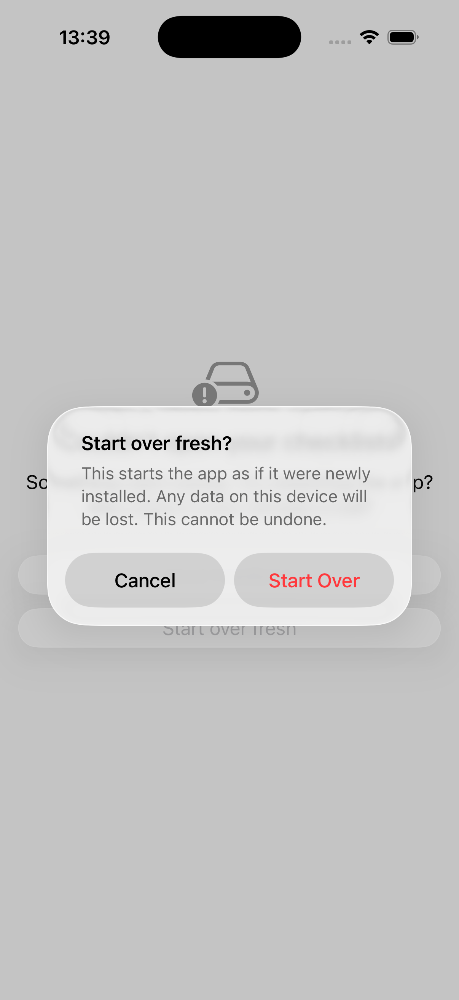

# Persistence

**Status: SwiftData with CloudKit sync** (`ProductionContainerFactory.cloudKitEnabled`), with a
local-only store as the fallback whenever the CloudKit store will not open. **The pre-flight
checklist below is therefore live, not hypothetical** — in particular, an App Store build talks
only to the CloudKit **Production** environment, so the schema must be deployed there before 2.0
ships.

This document is canonical for the data model, the constraints it was designed against, the
one-time legacy import, sort-key ordering, duplication, autosave, and the startup/failure UX. The sibling
[`analytics-spec.md`](analytics-spec.md) is canonical for analytics; this file does not repeat
it.

## Model

Two `@Model` types, `Checklist` and `Item`, in `checklists/checklists/DataModels/`; their
declarations are the field list. The one rule the declarations cannot enforce: **app code reads
`Checklist.items`, never `itemsStorage`.** The relationship is an unordered set as far as CloudKit
is concerned, so `items` re-sorts it by `sortKey` (falling back to `id` to keep ties total and
stable) on every read.

### The two history stamps

`lastUpdated` and `lastCompleted` are both optional, and follow deliberately different rules.

- **`lastUpdated` records an action: an item's checked state changed.** One checkbox, or every item
  at once via Reset. Renaming, re-noting, reordering, adding and deleting are *edits*, not updates,
  and leave it alone — so "update" means exactly this throughout the codebase, and
  `PersistenceOperation.itemUpdate` tags the saves that cause it.
- **`lastCompleted` records a state transition: the list *became* complete**, by whatever local
  route. Usually the final tick, but deleting the one item still outstanding counts too, because
  people model "this list is done, when did that happen" rather than how it got done — a full
  progress ring above a caption denying the list was ever completed reads as a bug. An empty list
  is never complete (`Checklist.isComplete`), so deleting every item does not qualify. It survives
  Reset: it is a record of a finished run, not a claim about the list's current state.

Nothing ever clears either stamp, and an already-complete list is not restamped.

**Both read as "Never" rather than disappearing when unset.** The checklist screen's caption is
always two lines, which fixes the header's height — that is what lets it rewrite the caption on
every tick without re-measuring the `tableHeaderView` or shifting the rows under the reader's
finger. The create sheet is the one screen that hides the caption, because there both lines could
only ever say "Never"; `ChecklistViewController` decides that once at load rather than reading
`isNewChecklist` live, which `viewDidAppear` clears.

**A merge arriving at 100% must never stamp `lastCompleted`.** The device that actually completed
the list already stamped it and that field syncs; a local restamp would win last-writer-wins and
replace the true completion moment with the merge time. This is why `handleRemoteChange` records
nothing.

Both are declared under `SchemaV1` (`DataModels/SchemaV1.swift`) and registered with
`ChecklistsMigrationPlan` (`DataModels/ChecklistsMigrationPlan.swift`), whose `stages` array is
empty today — `SchemaV1` is the first SwiftData schema, so there is nothing to migrate *from*
within SwiftData yet. See "CloudKit rules" below for what changing either model now costs.

## CloudKit rules

`SchemaV1` satisfies CloudKit's constraints on a `ModelConfiguration`:

- **No unique constraints** (`@Attribute(.unique)`) anywhere. CloudKit has no way to enforce
  uniqueness across devices that write while offline, so a unique attribute in SwiftData's schema
  makes `ModelContainer` creation with a CloudKit configuration throw outright.
- **Every relationship is optional, and the inverse is declared once.** `Checklist.itemsStorage`
  carries the `@Relationship(deleteRule:inverse:)`; `Item.checklist` is a plain optional property
  with no macro, which is the correct SwiftData idiom — annotating both sides risks two
  relationships instead of one reciprocal pair. Separately, and for its own reason, `Reordering`
  assigns only the child side at runtime. Both are optional because CloudKit syncs a record graph in
  pieces, so a child record can legitimately arrive before its parent (or vice versa); a
  non-optional relationship would be unsatisfiable during that window.
- **Every non-optional attribute has a default value** (`= ""`, `= UUID().uuidString`, `= 0.0`, …).
  CloudKit record decoding fills in the default rather than failing when a field is briefly absent.
- **No ordered relationships** — CloudKit relationships are unordered sets, full stop. Hence
  `sortKey` instead of relying on array position; see "Sort keys" below.
- **No `.deny` delete rule.** `Checklist.itemsStorage` uses `.cascade`; a `.deny` rule can leave a
  parent record permanently undeletable if a sync merge lands a child CloudKit has not told this
  device to delete yet.
- **The production CloudKit schema is additive-only once deployed.** A record type or field that has
  reached production can never be removed or renamed — only added to. From that point on, any model
  change is a new `VersionedSchema` (`SchemaV2`, …) plus a `MigrationStage` in
  `ChecklistsMigrationPlan.stages` plus a migration test, never an edit to `SchemaV1` in place. See
  the doc comment atop `DataModels/SchemaV1.swift`, and the "SwiftData schema migration"
  cross-cutting check in `.claude/skills/create-pr/reference/review-and-gate.md`.

## Legacy import

`Persistence/LegacyRealmImporter.swift` copies a pre-migration install's Realm store into SwiftData
**once**, and is not itself a `SchemaMigrationPlan` stage — that mechanism moves data between two
versions of *one* SwiftData schema, while this moves data between two entirely different persistence
frameworks.

Three properties hold, in priority order — never deletes data, idempotent, verifies before declaring
success. They, and what does and does not delete the Realm file, are canonical on the type's own
doc comment.

**It gives up after `LegacyRealmImporter.maximumAttempts` failures**, sets the completion flag, and
lets the app open, keeping the Realm file; the reasoning is on `abandonIfOutOfAttempts`.
`legacy_import_abandoned` counts it — these are users whose old data is now out of reach, so the
number matters (analytics-spec.md §Product questions).

Checklist order comes from the old `LegacyGroup.checklists` `List`, since that was the only record of
display order in the Realm schema; any checklist reachable in the store but not linked from the
`Group` (which should not happen, but would be invisible and unrecoverable if dropped) is appended
at the end rather than discarded.

**v1.0.0 stores are not importable**, by decision: the current Realm cannot open their file format,
so those installs are abandoned on their first launch, with the file kept. The reason is on
`LegacyRealmImporter`.

## Sort keys

`Persistence/SortKeyReorder.swift` is canonical for the ordering arithmetic: midpoint insertion,
renormalization once a gap falls below `epsilon`, and why that floor sits where it does.

**Imported checklists do not start at 1.** `LegacyRealmImporter` gives each device's import a
random block of keys rather than numbering from `step`, so two devices importing the same Realm
file independently keep their orderings separate instead of interleaving into one scrambled list.
The block arithmetic and the collision odds are on `LegacyRealmImporter`'s own constants; item keys
are unaffected and still start at `step`.

## Duplication

`Persistence/ChecklistDuplication.swift` deep-copies a checklist; `ItemDuplication.swift` copies one
item within its checklist; `CheckedItemCopying.swift` copies a checklist's checked items into a new
or existing list, and moves them by deleting the originals once the copy has saved. All re-issue sort keys rather than copying them. **None carries over item status
or either history stamp**, since all three describe something that happened to the original list
being run, and nothing has been run on the copy yet.

Worth knowing from here: checklist duplication saves the whole graph once and removes the
half-built copy if that save fails — see §Save failures. Edit mode's bulk duplicate is
`ModelContext.duplicateChecklists(ids:)`, whose doc comment covers its partial-failure behaviour.

## Startup and failure UX

### The failure screen

| Failure screen | Start-over confirmation |
|---|---|
|  |  |

It appears when any of three stages fails: the container could not be created, the one-time Realm
import did not complete, or first-launch seeding could not save. A CloudKit-backed store that will
not open is not a cause of the first — `ProductionContainerFactory` attempts it and falls through
to the local one on any throw, so that degrades sync, never startup. The seed and import saves do
go to a possibly CloudKit-backed context, so they are not equally insulated. In practice the
realistic causes are a full disk and a corrupt store.

**Which stage failed decides what the screen offers**, because the three are not equally
recoverable. `ContainerCreationFailure.stage` records it, set per `try` rather than inferred from
the error — the import throws Realm's errors and its own `ImportError`, neither of which carries a
stage, and a `PersistenceError`'s `PersistenceOperation` answers "which save" rather than "how far
did launch get".

"Start over fresh" (`StoreReset`) is the escape hatch of last resort, offered only where
`ContainerCreationFailure.allowsStoreReset` says so; the reasoning for that gate is there. Stages
it excludes get the feedback path alone, and the body copy's suggestion to relaunch — nothing is
deleted by reaching the screen, so a relaunch is a real chance of recovery. There is no Retry
control; the only in-app re-run is `AppStartupModel.rerunAfterStoreReset()`, reached *after* the
reset has already deleted every local store.

### Startup sequence

`Persistence/AppStartupCoordinator.swift` owns everything between process start and the first
screen having data: opening the store, running the legacy import, seeding a brand-new install. It's
kept out of the app's entry point (`AppStartupModel`, which the SwiftUI `ChecklistsApp` observes)
so the whole sequence is one testable, retryable unit rather than scattered init-time side effects.

**Coordinator order**, inside `AppStartupCoordinator.run()`:

1. Build the `ModelContainer` (`LaunchModeContainerFactory.make`, defaulting to
   `ProductionContainerFactory.make` outside of tests — see below). Tagged `.storeOpen`.
2. `LegacyRealmImporter.importIfNeeded(into:)`. Tagged `.legacyImport`.
3. `SampleData.insertFirstTimeLaunchDataIfNeeded(into:)` — a no-op if the import (or a prior launch)
   already populated the store. Tagged `.firstLaunchSeed`.
4. `SampleData.dedupeChecklists(in:)`, whose failure is swallowed (reason at the `try?`). Step 3
   cannot see iCloud data that has not imported yet, so every fresh install on an account that
   already has the samples seeds a second copy. Dedupe drops redundant untouched copies once the
   import lands (it also runs on each remote-change burst), preferring any copy with added items or
   changed checks. It decides nothing for a sample while a copy has fewer items than the original,
   since that copy may still be arriving. Copies that differ only in text, such as another
   language's, are kept. Samples the user deleted come back after a reinstall or on a new device, by
   decision: the reasoning is on `dedupeChecklists`.
5. Install the result as `PersistenceController.shared`.

Steps 2–4 are skipped entirely under `LaunchModeContainerFactory.isRunningTests` — automated tests
get an already-seeded in-memory container (`InMemoryModelContainer.makeSeeded()`), where running the
Realm importer would be both wrong (there is no Realm file) and slow. That is also why the
coordinator takes the two stage closures as injectable parameters.

**The migration screen appears only on the launch that actually imports.** `AppStartupModel.init()`
checks `AppStartupCoordinator.willImportLegacyData` *before* running startup, and only then enters
the `.loading` phase (rendering `LoadingView`); the coordinator then runs on the main actor after
one `Task.yield()`, which gives the loading screen its first frame. Every other launch — almost all
of them, since the import runs at most once per device — runs startup synchronously and goes
straight to the checklist list.

**The screen has a 1.5-second floor** (`AppStartupModel.minimumMigrationScreenDuration`). The copy
itself takes a small fraction of that for any realistic amount of data, so without a floor the
screen would flash by unread; the floor exists purely so a user who is about to see the app's
launch experience change actually gets to read the message.

**A failure screen, never `fatalError`.** If container creation, the legacy import, or the
first-launch seed throws, `AppStartupCoordinator.run()` returns `.failed(ContainerCreationFailure)`
instead of propagating the error, and `ChecklistsApp` shows `ContainerFailureView`.

## Save failures

- **A failed save leaves no staged record behind.** A path that inserts before it saves deletes
  what it inserted — unlinking an item from its checklist first — and restores any sort keys it
  moved, then rethrows. The screens render from the context rather than from disk, so a leftover
  record would look saved, and autosave might write it later (§Autosave).
- **The person is told, from `saveChanges`.** It calls `SaveFailureNotifier`, which the app root
  wires to an error toast. `PersistenceOperation.notifiesOnFailure` says which saves are excluded.

## Autosave

**Nothing in this repo ever sets `autosaveEnabled`**, and SwiftData's default is on — for the app's
`container.mainContext` (which is both `PersistenceController.mainContext` and the `\.modelContext`
that `.modelContainer(_:)` publishes) *and* for the hand-built `ModelContext(container)` every unit
test writes through. `AutosaveDefaultsTests` pins both, because they are a framework's defaults
rather than ours and the rest of this section reasons from them.

So the explicit `saveChanges(operation:)` calls are not the only thing that persists a change. What
they add is an ordering point and a failure report — which is most of their value, but not all of
what a reader tends to assume they are.

Two consequences:

- `saveChangesIgnoringFailure` dropping an error does not by itself decide the write is lost; a
  later autosave may commit the same pending changes with nothing reported either way. It equally
  may not: the failures that reach it are usually store-level and persistent, so the next attempt
  tends to fail identically. Neither outcome is observable from the call site, which is the real
  point.
- A test that means to prove a failed save persisted nothing cannot get that from its context
  holding changes back, since it does not.

## File protection

The app sets **no** `com.apple.developer.default-data-protection` entitlement, and the Xcode
project carries no Data Protection capability. That is deliberate, not an oversight: with no
entitlement, iOS applies `NSFileProtectionCompleteUntilFirstUserAuthentication` to the app's files
by default, which is the level the store needs.

It matters for sync. Under `NSFileProtectionComplete` the store's files are unreadable whenever the
device is locked, so a CloudKit push arriving in the background cannot be merged and has to wait
for the next unlock. The default class keeps the store readable after the first unlock following a
boot, which is what lets background sync make progress.

Do not add the entitlement explicitly: the value is baked into the provisioning profile, so stating
it breaks automatic signing.

**The trade-off is real and was taken knowingly:** files are readable after first unlock rather than
only while unlocked. That is a small reduction in at-rest protection against an attacker with
physical possession of a locked, powered-on device. Restoring `NSFileProtectionComplete` means
changing the App ID's Data Protection level in the developer portal *and* accepting that background
sync only progresses while the device is unlocked.

Existing files keep the protection class they were created with, so an upgrading user's Realm file
stays at Complete. It is only ever read at launch, in the foreground, so that costs nothing.

## Sync status

`Persistence/SyncStatus.swift` is the user-facing half of "is my data syncing?" — it turns two
independent signals, plus observed sync activity, into the single row Settings shows.

**Two signals, because they answer different questions and can disagree:**

- `containerBacking` (`ContainerBacking`) — which store *this launch* ended up on; the enum's doc
  says who decides it.
- `accountStatus` (`SyncStatus.AccountStatus`: `.checking`, `.available`, `.noAccount`,
  `.restricted`, `.temporarilyUnavailable`, `.couldNotDetermine`) — whether the user is *currently*
  signed in to iCloud, a live signal that can change while the app is running (sign-in, sign-out,
  account switch) independently of which store this launch picked.

Collapsing them into one flag would lose exactly the case that matters most: a signed-in user whose
launch nonetheless fell back to the local store. `SyncStatus.rowState` is the switch that maps the
pair, plus observed sync activity, to the Settings row's state — read it there rather than here.

**Row-state precedence.** `rowState` resolves `.checking` → an account problem
(`.unavailable`/`.restricted`/`.needsAttention`/`.couldNotCheck`) → `.paused` (local fallback) → a
sync failure (`.storageFull`/`.syncInterrupted`) → `.available`, in that order. An account problem
outranks `.paused` because it explains why syncing isn't happening even more directly than "this
launch fell back to local storage" does. Sync failures only reach the row from `syncActivity`'s
latest per-operation error: `CKError.quotaExceeded` is `.storageFull`; `.networkUnavailable`,
`.networkFailure`, `.serviceUnavailable`, `.requestRateLimited`, and `.zoneBusy` never change the
row (they're transient and `NSPersistentCloudKitContainer` retries them); any other failure is
`.syncInterrupted`. All of this still reaches diagnostics and analytics regardless of what the row
shows.

**`.paused` is the state worth dwelling on.** It exists only because `containerBacking` and
`accountStatus` can disagree — any throw from the CloudKit-configured container initializer falls
back to the local store for that launch even though the user's iCloud account is fine (see
`ProductionContainerFactory.cloudKitEnabled`). Reporting that as plain "unavailable" would wrongly
send a signed-in user off to check their Apple ID; reporting it as plain "available" would hide that
this launch isn't syncing at all. `.paused` says the true thing: your data is safe on this device, it
just isn't syncing this launch, and relaunching may fix it — which is exactly the copy the Settings
row's footer gives for that state.

**Presentation is computed on the model.** `SyncStatus.rowPresentation` (`Persistence/SyncStatusPresentation.swift`)
turns `rowState` into the row's title, footer, SF Symbol name, and warning flag; `SettingsView`
only renders it. The Active row's footer names the most recent sync success across `setup`/
`import`/`export`, formatted as a relative time, and is omitted until the first one this launch.

**Where it's loaded and observed.** `PersistenceController` owns one `SyncStatus` per launch,
constructed in its `init` from the `containerBacking` it was already given, so `containerBacking`
is fixed for the controller's lifetime — a retry that resolves differently installs a whole new
`PersistenceController` (and thus a fresh `SyncStatus`) rather than mutating one in place.
`accountStatus` starts at `.checking` and is written by `ChecklistsApp`, on the `.ready` branch, not
by `SettingsView` — so analytics and the Feedback diagnostics see it whether or not Settings ever
opens. Two `.task`s run for the app's lifetime: one awaits `ICloudStatusLoader().load(into:)` once,
the other observes `.CKAccountChanged` and `.NSUbiquityIdentityDidChange` and re-loads on each, so
the row (and diagnostics) track an account change without opening Settings.

**Sync activity and the fallback error.** `syncActivity` (`[SyncOperation: SyncOperationState]`,
`CloudKitSyncMonitor`) records each of `setup`/`import`/`export`'s last success and latest failure
from `NSPersistentCloudKitContainer.eventChangedNotification`, only while this launch is
CloudKit-backed. `fallbackError` (`SyncErrorCode?`, set once in `PersistenceController.init`) is the
domain and code `ProductionContainerFactory` caught when the CloudKit container failed to open — the
error the `.paused` row has no way to show. Both feed the Feedback email's diagnostics block
(`SyncDiagnostics.report`), analytics (`icloud_status_checked`, `cloudkit_container_fell_back`,
`cloudkit_sync_failed`), and `syncActivity` also feeds the Settings row's precedence above.

**The live call needs the `application-identifier` entitlement, and nothing in Swift can rescue it
if it is missing.** `CKContainer.default()` derives its container from that entitlement; with no
entitlement there is no container identifier, and CloudKit reports the fault by raising the
Objective-C exception `CKException` ("containerIdentifier can not be nil"). An ObjC exception is not
a Swift `Error`, so the `do`/`catch` in `load(into:)` — which otherwise maps a thrown error and every
non-`.available` `CKAccountStatus` case to its own `AccountStatus` — cannot see it and the process
aborts instead of degrading into the existing "iCloud Not Available" row.

**Why `CODE_SIGNING_ALLOWED=NO` matters here:** it skips the packaging step that would otherwise
write a simulator build's entitlements blob — see `scripts/build.sh`.

## CloudKit ops record

**Container:** `iCloud.com.jimmyho.checklists`, private database, assigned to the
`com.jimmyho.checklists` App ID with the iCloud (CloudKit) and Push Notifications capabilities. The
app declares `com.apple.developer.icloud-container-identifiers`,
`com.apple.developer.icloud-services`, `aps-environment`, and the `remote-notification` background
mode — CloudKit delivers change notifications as silent pushes, so without that mode remote edits
only arrive when the app is next opened.

**Two environments, two schemas.** A development-signed build talks to CloudKit's **Development**
environment; TestFlight and App Store builds talk to **Production**. They hold separate schemas, so
sync working perfectly from Xcode proves nothing about TestFlight until the schema is promoted. The
Development schema is created automatically the first time real records are uploaded; Production
requires a manual **Deploy Schema Changes** click in CloudKit Console. There is no `cktool`
equivalent — `import-schema --environment production` is accepted as a flag and rejected by the
server.

**Promotion is one-way.** Once a record type or field reaches Production it can never be removed or
renamed, only added to. "Remove a field" becomes "stop reading it". This is what freezes `SchemaV1`
in the stronger sense described under "CloudKit rules"; before the first promotion the schema is
still free to change.

### Before the first TestFlight build

- [ ] Confirm `CD_Checklist` and `CD_Item` exist in the **Development** environment, generated by a
      real signed run rather than hand-authored.
- [ ] Audit the exported schema against the models in both directions — every stored property has a
      `CD_` field, and every field traces to a current property. A to-many relationship appears as
      the inverse foreign key (`CD_checklist`) on the **child** record type, not on the parent.
- [ ] Deploy to Production in CloudKit Console; verify by re-exporting.
- [ ] **Check `aps-environment` in the archived build.** The checked-in entitlements say
      `development`; Xcode normally rewrites it to `production` at export. If it does not, silent
      pushes fail against production APNs and sync silently degrades to arriving only on next
      launch, with nothing visibly broken. Verify on the actual archive rather than assuming.
- [ ] Two-device tests: union across devices that never synced, edits propagating both ways, and a
      pair of fresh installs collapsing to three samples rather than six, and a reinstall on an
      account with an edited sample coming back to three with the edit intact.

## Realm removal plan

- **v1.3**: the Realm file left by `LegacyRealmImporter` is deleted from disk, once enough of the
  install base has had a release cycle to complete its one-time import. This does not touch the
  `RealmSwift` package dependency.
- **Dropping the `RealmSwift` package dependency itself is a later, separate decision**, made only
  once enough of the install base is confidently past v1.1.0 (the last Realm-only release). Anyone
  who upgrades directly from v1.1.0 straight to a build without `RealmSwift` linked at all would have
  no reader for their old store and nothing to import from — silent data loss on upgrade, not a
  crash. That is a materially different risk than deleting an already-imported file, which is why the
  two are separate decisions on separate timelines.
