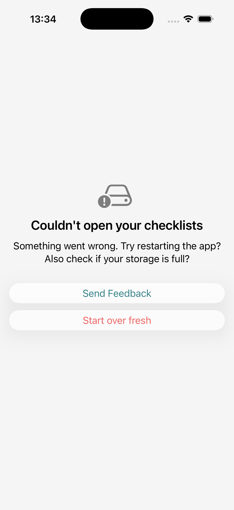

# Persistence

**Status: SwiftData with CloudKit sync.** The app persists with SwiftData as of the Realm→SwiftData
migration (Stage 1); CloudKit sync was switched on in #133
(`ProductionContainerFactory.cloudKitEnabled = true`), with a local-only store as the fallback
whenever iCloud is unavailable. **The pre-flight checklist below is therefore live, not
hypothetical** — in particular, an App Store build talks only to the CloudKit **Production**
environment, so the schema must be deployed there before 1.2 ships.

This document is canonical for the data model, the constraints it was designed against, the
one-time legacy import, sort-key ordering, and the startup/failure UX. The sibling
[`analytics-spec.md`](analytics-spec.md) is canonical for analytics; this file does not repeat
it.

## Model

Two `@Model` types, both in `checklists/checklists/DataModels/`:

- **`Checklist`** (`Checklist.swift`) — `id`, `name`, `notes`, `sortKey`, and `itemsStorage`, the
  `@Relationship(deleteRule: .cascade, inverse: \Item.checklist)` to its items. App code never reads
  `itemsStorage` directly; the `items` computed property re-sorts it by `sortKey` (falling back to
  `id` to keep ties total and stable) on every read, because a to-many relationship is an unordered
  set as far as CloudKit is concerned.
- **`Item`** (`Item.swift`) — `id`, `name`, `notes`, `sortKey`, `statusRaw` (an `Int`; `status` is a
  computed `Item.Status` wrapper so it stays filterable in a `#Predicate` and legible in the
  CloudKit dashboard), and `checklist`, the inverse of `itemsStorage`.

Both are declared under `SchemaV1` (`DataModels/SchemaV1.swift`) and registered with
`ChecklistsMigrationPlan` (`DataModels/ChecklistsMigrationPlan.swift`), whose `stages` array is
empty today — `SchemaV1` is the first SwiftData schema, so there is nothing to migrate *from*
within SwiftData yet. See "CloudKit rules" below for what changing either model now costs.

### What the old Realm schema had that these don't

- **`Group`** — a singleton object that existed only to hold checklists in an ordered `List` (see
  `checklists/checklists/DataModels/LegacyRealmSchema.swift` for the schema it shipped). A singleton
  is exactly the shape CloudKit cannot express: two devices that each create their "one" `Group`
  before their first sync end up with two of them and no principled way to pick a winner. Dropped
  entirely — ordering now lives on each record via `sortKey` (see "Sort keys" below).
- **`sortNumber`** — the old array-index-shaped ordering field `Group.checklists`/`Checklist.items`
  made redundant once ordering moved off the collection and onto the record.
- **`lastModified`** — present on the Realm schema, never read anywhere in the app. Not carried
  forward; nothing depended on it.

## CloudKit rules

`SchemaV1` is written to already satisfy CloudKit's constraints on a `ModelConfiguration`, even
though CloudKit sync itself is off in this stage. Turning it on later should require no schema
change:

- **No unique constraints** (`@Attribute(.unique)`) anywhere. CloudKit has no way to enforce
  uniqueness across devices that write while offline, so a unique attribute in SwiftData's schema
  makes `ModelContainer` creation with a CloudKit configuration throw outright.
- **Every relationship is optional, with an explicit inverse.** `Checklist.itemsStorage` and
  `Item.checklist` are both optional `@Relationship` properties. CloudKit syncs a record graph in
  pieces, so a child record can legitimately arrive before its parent (or vice versa); a
  non-optional relationship would be unsatisfiable during that window.
- **Every non-optional attribute has a default value** (`= ""`, `= UUID().uuidString`, `= 0.0`, …).
  CloudKit record decoding fills in the default rather than failing when a field is briefly absent.
- **No ordered relationships** — CloudKit relationships are unordered sets, full stop. Hence
  `sortKey` instead of relying on array position; see "Sort keys" below.
- **No `.deny` delete rule.** `Checklist.itemsStorage` uses `.cascade`; a `.deny` rule can leave a
  parent record permanently undeletable if a sync merge lands a child CloudKit has not told this
  device to delete yet.
- **The production CloudKit schema is additive-only once deployed.** A record type or field that has
  reached production can never be removed or renamed — only added to. From that point on, any model
  change is a new `VersionedSchema` (`SchemaV2`, …) plus a `MigrationStage` in
  `ChecklistsMigrationPlan.stages` plus a migration test, never an edit to `SchemaV1` in place. See
  the doc comment atop `DataModels/SchemaV1.swift`, and the "SwiftData schema migration"
  cross-cutting check in `.claude/skills/create-pr/SKILL.md`.

## Legacy import

`Persistence/LegacyRealmImporter.swift` copies a pre-migration install's Realm store into SwiftData
**once**, and is not itself a `SchemaMigrationPlan` stage — that mechanism moves data between two
versions of *one* SwiftData schema, while this moves data between two entirely different persistence
frameworks.

Three properties hold, in priority order (see the type's own doc comment for the full reasoning):

1. **It never loses data.** The Realm file is never deleted by this release, here or anywhere else.
   If anything fails, the original store is untouched and the import simply runs again next launch.
2. **It is idempotent.** Records are upserted by their existing `id` (`upsert(_:into:)`), so a rerun
   after a crash or a failed flag write adds nothing and changes nothing.
3. **It verifies before declaring success.** `verify(_:in:)` reads every copied checklist and item
   back out of SwiftData before `LegacyRealmImporter.completedFlagKey` is set. A partial import
   leaves the flag unset and is retried, rather than being silently accepted as complete.

Checklist order comes from the old `LegacyGroup.checklists` `List`, since that was the only record of
display order in the Realm schema; any checklist reachable in the store but not linked from the
`Group` (which should not happen, but would be invisible and unrecoverable if dropped) is appended
at the end rather than discarded. A store with no `Group` object at all predates v1.1.0, which
shipped `Group` in 2021; those builds ordered checklists by `Checklist.sortNumber` instead, so the
importer falls back to reading that field. Upgrading straight from a pre-v1.1.0 build is not a
supported path and is not tested beyond that one case — but the import runs once and never reads the
Realm file again, so anything it declines to read is lost permanently. Reading the older ordering
field costs nothing and is the difference between "unsupported" and "silently destroys their data",
which is why `sortNumber` is still carried on `LegacyChecklist` even though nothing else uses it.

**The Realm file is retained this release and deleted in v1.3.** Because it's a plain file, deleting
it needs no Realm API at all — a future change removes it with `FileManager.default.removeItem(at:)`
once enough of the install base has had a release cycle to complete its one-time import. See "Realm
removal plan" below for what comes after that.

## Sort keys

`Persistence/SortKeyReorder.swift` holds the ordering arithmetic, kept as pure functions
independent of SwiftData so it can be tested without a container (`SortKeyReorderTests`).

CloudKit relationships are unordered sets (see "CloudKit rules"), so "the order the user last
arranged things in" has to be stored as data on each record rather than inferred from array
position — `Checklist.sortKey` and `Item.sortKey`, both `Double`s, ascending.

**Midpoint insertion, not renumbering.** Moving or inserting a record assigns it the key exactly
between its two new neighbours (`SortKeyReorder.key(forInsertingAt:in:)`), so a reorder rewrites the
one record that moved rather than renumbering everyone after it. That matters once sync is on: a
renumber would turn every reorder into a diff across the whole list instead of one changed record.
The cost is that repeated insertions at the same spot keep halving the available gap; once a gap
shrinks below `SortKeyReorder.epsilon` (`1e-6`), the key function returns `nil` and the caller
(`Persistence/Reordering.swift`) renormalizes the whole list back to evenly spaced integers
(`1, 2, 3, …`, via `SortKeyReorder.renormalize`) and asks again — always splittable immediately
afterwards, since a fresh `step`-sized (`1.0`) gap is not exhausted.

**Why not array indices**, which would be simpler: an index is a property of the collection, and
CloudKit's relationships don't preserve collection order at all — see "No ordered relationships"
above. A `sortKey` field is just another synced attribute, so it survives the trip through CloudKit
the way an implicit array position cannot.

## Startup and failure UX

### The failure screen

Reproducing this screen means injecting a container failure into a debug build, so it is captured
here rather than left to imagination — nobody should have to break the app on purpose to find out
what a user in trouble is looking at.

| Failure screen | Start-over confirmation |
|---|---|
|  |  |

It appears only when the **local** store fails: the container could not be created, the one-time
Realm import did not complete, or first-launch seeding could not save. iCloud is never a cause —
`ProductionContainerFactory` attempts the CloudKit-backed store with `try?` and falls through to the
local one, so an unavailable account degrades sync, never startup. In practice the realistic causes
are a full disk and a corrupt store.

There is deliberately no Retry button. It re-ran the same startup sequence in the same process,
which is what relaunching does anyway and more thoroughly, so it offered a second route to the same
outcome while the copy already told the user to restart.

"Start over fresh" is the escape hatch of last resort — see `StoreReset` — because a corrupt store
cannot be repaired in place, and without it the app is permanently unusable. It deletes only local
stores, so a CloudKit-backed account repopulates on the next launch; for a corrupt local store that
is the best available outcome.

`Persistence/AppStartupCoordinator.swift` owns everything between process start and the first
screen having data: opening the store, running the legacy import, seeding a brand-new install. It's
kept out of the app's entry point (`AppStartupModel`, which the SwiftUI `ChecklistsApp` observes)
so the whole sequence is one testable, retryable unit rather than scattered init-time side effects.

**Coordinator order**, inside `AppStartupCoordinator.run()`:

1. Build the `ModelContainer` (`LaunchModeContainerFactory.make`, defaulting to
   `ProductionContainerFactory.make` outside of tests — see below).
2. `LegacyRealmImporter.importIfNeeded(into:)`.
3. `SampleData.insertFirstTimeLaunchDataIfNeeded(into:)` — a no-op if the import (or a prior launch)
   already populated the store.
4. Install the result as `PersistenceController.shared`.

Steps 2–3 are skipped entirely under `LaunchModeContainerFactory.isRunningTests` — automated tests
get an already-seeded in-memory container (`InMemoryModelContainer.makeSeeded()`), where running the
Realm importer would be both wrong (there is no Realm file) and slow.

**The migration screen appears only on the launch that actually imports.** `AppStartupModel.init()`
checks `AppStartupCoordinator.willImportLegacyData` *before* running startup, and only then enters
the `.loading` phase (rendering `LoadingView`) while `AppStartupCoordinator` runs on a
background `Task`. Every other launch — which is almost all of them, since the import runs at most
once per device — goes straight to the checklist list exactly as before.

**The screen has a 1.5-second floor** (`AppStartupModel.minimumMigrationScreenDuration`). The copy
itself takes a small fraction of that for any realistic amount of data, so without a floor the
screen would flash by unread; the floor exists purely so a user who is about to see the app's
launch experience change (and, once Stage 2 ships, learn that iCloud sync is now in play) actually
gets to read the message.

**A retryable failure screen, never `fatalError`.** If container creation, the legacy import, or the
first-launch seed throws, `AppStartupCoordinator.run()` returns `.failed(ContainerCreationFailure)`
instead of propagating the error, and `ChecklistsApp` shows `ContainerFailureView`, whose
"Start over fresh" path re-runs `AppStartupCoordinator().run()`. Nothing has been deleted at that point —
in particular the Realm file, per "Legacy import" above — so retrying is a real chance of recovery,
unlike the Realm-era `DBManager`, which called `fatalError` on any open failure and turned a
transient disk problem into a crash report with no recovery path.

## File protection

The app sets **no** `com.apple.developer.default-data-protection` entitlement, and the Xcode
project carries no Data Protection capability. That is deliberate, not an oversight: with no
entitlement, iOS applies `NSFileProtectionCompleteUntilFirstUserAuthentication` to the app's files
by default, which is the level the store needs.

It matters for sync. Under `NSFileProtectionComplete` — which is what shipped from 2019 until the
SwiftData migration — the store's files are unreadable whenever the device is locked, so a CloudKit
push arriving in the background cannot be merged and has to wait for the next unlock. The default
class keeps the store readable after the first unlock following a boot, which is what lets
background sync make progress.

The entitlement was briefly changed to state that level explicitly, which broke automatic signing:
the value is encoded in the provisioning profile, and the App ID has carried "Complete Protection"
since 2019. Removing the key reaches the same level without touching a live App ID. The sibling
**Wren** app (repo `simple-recurring-budgets`), which already ships SwiftData with CloudKit, sets no
data-protection entitlement either.

**The trade-off is real and was taken knowingly:** files are readable after first unlock rather than
only while unlocked. That is a small reduction in at-rest protection against an attacker with
physical possession of a locked, powered-on device. Restoring `NSFileProtectionComplete` means
changing the App ID's Data Protection level in the developer portal *and* accepting that background
sync only progresses while the device is unlocked.

Existing files keep the protection class they were created with, so an upgrading user's Realm file
stays at Complete. It is only ever read at launch, in the foreground, so that costs nothing.

## Sync status

`Persistence/SyncStatus.swift` is the user-facing half of "is my data syncing?" — it turns two
independent signals into the single four-state row Settings shows. Ported from the sibling
`simple-recurring-budgets` repo's `Sync/SyncStatus.swift`, trimmed of the App Store screenshot
override (no
marketing screenshot pipeline here yet) and using this project's existing `ContainerBacking`
enum rather than redeclaring one.

**Two signals, because they answer different questions and can disagree:**

- `containerBacking` (`ContainerBacking`, `.cloudKit` / `.localFallback`) — which store *this
  launch* ended up on, decided once by `ProductionContainerFactory` and never mutated afterwards.
- `accountStatus` (`SyncStatus.AccountStatus`, `.checking` / `.available` / `.unavailable`) — whether
  the user is *currently* signed in to iCloud, a live signal that can change while the app is
  running (sign-in, sign-out, account switch) independently of which store this launch picked.

Collapsing them into one flag would lose exactly the case that matters most: a signed-in user whose
launch nonetheless fell back to the local store. `SyncStatus.rowState` keeps them apart and maps
the pair to four states:

| containerBacking | accountStatus  | rowState       | What it tells the user |
|------------------|----------------|----------------|-------------------------|
| any              | `.checking`    | `.checking`    | Still finding out — show a spinner, not a verdict. |
| `.cloudKit`      | `.available`   | `.available`   | Signed in, this launch is on CloudKit — sync is active. |
| `.cloudKit`      | `.unavailable` | `.unavailable` | Not signed in — nothing to sync to; sign in to enable it. |
| `.localFallback` | `.available`   | `.paused`      | Signed in, but *this launch* is on the local store — edits are safe, just not syncing. |
| `.localFallback` | `.unavailable` | `.unavailable` | Neither signed in nor on CloudKit — same message as the CloudKit/unavailable row. |

**`.paused` is the state worth dwelling on.** It exists only because `containerBacking` and
`accountStatus` can disagree — CloudKit container construction can fail at launch (transient
network trouble, a `CKContainer` hiccup) even though the user's iCloud account is fine, which
falls back to the local store for that launch (see "Startup and failure UX" above). Reporting that
as plain "unavailable" would wrongly send a signed-in user off to check their Apple ID; reporting
it as plain "available" would hide that this launch isn't syncing at all. `.paused` says the true
thing: your data is safe on this device, it just isn't syncing this launch, and relaunching may
fix it — which is exactly the copy the Settings row's footer gives for that state.

**Where it's loaded and observed.** `PersistenceController` owns one `SyncStatus` per launch,
constructed in its `init` from the `containerBacking` it was already given, so `containerBacking`
is fixed for the controller's lifetime — a retry that resolves differently installs a whole new
`PersistenceController` (and thus a fresh `SyncStatus`) rather than mutating one in place.
`accountStatus` starts at `.checking` and is written by `SettingsView`, which runs two `.task`s
while it is on screen: one awaits `ICloudStatusLoader().load(into:)` once, the other observes
`.CKAccountChanged` and `.NSUbiquityIdentityDidChange` and re-loads on each, so the row tracks an
account change without a dismiss and re-open. SwiftUI cancels both when the sheet goes away, so
nothing keeps running once the screen is dismissed.

**Why `ICloudStatusLoader` takes its query as a closure.** `Persistence/ICloudStatusLoader.swift`
wraps the actual `CKContainer.default().accountStatus()` call behind an injectable
`accountStatus: () async throws -> CKAccountStatus` property because `CKContainer` cannot be
stubbed — there is no other seam to drive `.available` / `.noAccount` / a thrown error through in
a unit test. Production uses the live CloudKit call; `ICloudStatusLoaderTests` injects the three
outcomes (plus a two-phase sign-in transition) directly. The loader also short-circuits to
`.noAccount` under `#if DEBUG` when `IS_TESTING` is set or `-UITests1` is passed on the command
line, because `CKContainer.accountStatus()` hangs on an account-less Simulator and would otherwise
pin the row to a spinner and block UI tests from ever reaching Settings.

**The live call needs the `application-identifier` entitlement, and nothing in Swift can rescue it
if it is missing.** `CKContainer.default()` derives its container from that entitlement; with no
entitlement there is no container identifier, and CloudKit reports the fault by raising the
Objective-C exception `CKException` ("containerIdentifier can not be nil"). An ObjC exception is not
a Swift `Error`, so the `do`/`catch` in `load(into:)` — which otherwise makes good on "anything else
or a thrown error → unavailable" — cannot see it and the process aborts instead of degrading into
the existing "iCloud Not Available" row.

A simulator build carries its entitlements in the `…app-Simulated.xcent` blob rather than in the
code signature, so `codesign -d --entitlements -` prints nothing for a simulator `.app` whether or
not the entitlements are present — it is not a useful check. `strings` for the
`application-identifier` value is. Passing `CODE_SIGNING_ALLOWED=NO` skips the packaging step that
writes that blob, which is why `scripts/build.sh` and the CI build no longer pass it (#140); the
test scripts never did. Note this only guarantees that *our* build paths produce a launchable
binary — any other tool that builds this project with signing disabled reintroduces the crash, and
the shipped-build gap (a release whose profile lost the iCloud capability) is still open, since the
exception remains uncatchable from Swift.

## CloudKit ops record

**Container:** `iCloud.com.jimmyho.checklists`, private database, assigned to the
`com.jimmyho.checklists` App ID with the iCloud (CloudKit) and Push Notifications capabilities. The
app declares `com.apple.developer.icloud-container-identifiers`,
`com.apple.developer.icloud-services`, `aps-environment`, and the `remote-notification` background
mode — CloudKit delivers change notifications as silent pushes, so without that mode remote edits
only arrive when the app is next opened.

**Two environments, two schemas.** A development-signed build talks to CloudKit's **Development**
environment; TestFlight and App Store builds talk to **Production**. They hold separate schemas, so
sync working perfectly from Xcode proves nothing about TestFlight until the schema is promoted. The
Development schema is created automatically the first time real records are uploaded; Production
requires a manual **Deploy Schema Changes** click in CloudKit Console. There is no `cktool`
equivalent — `import-schema --environment production` is accepted as a flag and rejected by the
server.

**Promotion is one-way.** Once a record type or field reaches Production it can never be removed or
renamed, only added to. "Remove a field" becomes "stop reading it". This is what freezes `SchemaV1`
in the stronger sense described under "CloudKit rules"; before the first promotion the schema is
still free to change.

### Before the first TestFlight build

- [ ] Confirm `CD_Checklist` and `CD_Item` exist in the **Development** environment, generated by a
      real signed run rather than hand-authored.
- [ ] Audit the exported schema against the models in both directions — every stored property has a
      `CD_` field, and every field traces to a current property. A to-many relationship appears as
      the inverse foreign key (`CD_checklist`) on the **child** record type, not on the parent.
- [ ] Deploy to Production in CloudKit Console; verify by re-exporting.
- [ ] **Check `aps-environment` in the archived build.** The checked-in entitlements say
      `development`; Xcode normally rewrites it to `production` at export. If it does not, silent
      pushes fail against production APNs and sync silently degrades to arriving only on next
      launch, with nothing visibly broken. Verify on the actual archive rather than assuming.
- [ ] Two-device tests: union across devices that never synced, edits propagating both ways, and a
      pair of fresh installs collapsing to three samples rather than six.

## Realm removal plan

- **v1.3**: `LegacyRealmImporter`'s Realm file is deleted from disk (see "Legacy import" above).
  This does not touch the `RealmSwift` package dependency — it only removes the on-disk file left
  over from before the user's device ever ran a SwiftData build.
- **Dropping the `RealmSwift` package dependency itself is a later, separate decision**, made only
  once enough of the install base is confidently past v1.1.0 (the last Realm-only release). Anyone
  who upgrades directly from v1.1.0 straight to a build without `RealmSwift` linked at all would have
  no reader for their old store and nothing to import from — silent data loss on upgrade, not a
  crash. That is a materially different risk than deleting an already-imported file, which is why the
  two are separate decisions on separate timelines.
